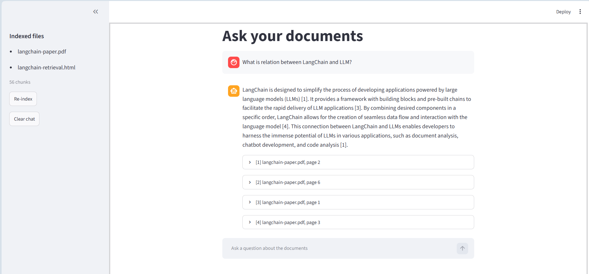
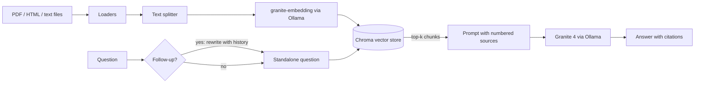

# LangChain Essentials with IBM Granite, running locally


> Based on IBM's **"Build Smarter AI Apps: Empower LLMs with LangChain"** lab
> (*Develop Generative AI Applications: Get Started* course on Coursera),
> rebuilt to run **fully locally and free** on IBM Granite via Ollama, and extended
> into a document Q&A assistant with citations and a measured retrieval evaluation.



## What this project covers

Every lab section is a standalone script, and all 7 exercises are solved with custom examples.

| Lab section | Where it's implemented |
|---|---|
| Models and chat models | `scripts/01_model.py` |
| Chat messages (system, human, AI, history) | `scripts/02_chat_messages.py` |
| **Exercise 1:** compare models and temperatures | `scripts/03_compare_models.py`, `src/lclab/compare.py` |
| Prompt templates (`PromptTemplate`, `ChatPromptTemplate`, `MessagesPlaceholder`) | `scripts/04_prompt_templates.py` |
| Output parsers (JSON, comma-separated list) | `scripts/05_output_parsers.py` |
| **Exercise 2:** JSON parser chain (books) | `scripts/06_book_json.py`, `src/lclab/parsers.py` |
| Documents, loaders, text splitters | `scripts/07_documents.py`, `src/lclab/documents.py` |
| **Exercise 3:** compare two splitters | `scripts/08_splitter_comparison.py` |
| Embeddings and vector stores (Chroma) | `scripts/09_embeddings_vectorstore.py` |
| Retrievers (vector store, parent document) and RetrievalQA | `scripts/10_retrievers.py` |
| **Exercise 4:** retrieval system with grounded answers | `scripts/11_retrieval_qa.py`, `src/lclab/retrieval.py` |
| Memory (chat history, conversation buffer) | `scripts/12_memory.py` |
| **Exercise 5:** chatbot with buffer, summary and checkpointer memory | `scripts/13_memory_chatbot.py`, `src/lclab/memory.py` |
| Chains (`LLMChain`, `SequentialChain`, LCEL) | `scripts/14_chains.py` |
| **Exercise 6:** review pipeline, traditional vs LCEL | `scripts/15_review_pipeline.py`, `src/lclab/chains.py` |
| Tools, toolkits and ReAct agents | `scripts/16_tools_agents.py` |
| **Exercise 7:** agent with a calculator and a text formatter | `scripts/17_agent_exercise.py`, `src/lclab/tools.py` |
| **Extension A:** "Ask your documents" assistant | `scripts/18_ask_docs.py`, `app.py`, `src/lclab/doc_qa.py` |
| **Extension B:** retrieval evaluation (hit@k, MRR) | `scripts/19_retrieval_eval.py`, `src/lclab/evaluation.py` |
| Automated tests + CI | `tests/`, `.github/workflows/tests.yml` |

Each script starts with a short header: its **aim**, **what you'll see** and **what to notice**.

## What's different from the original lab

**Changed to run locally (no cloud account, no cost)**
- IBM watsonx.ai → **Ollama**, running IBM Granite 4 (`granite4:tiny-h`) on a consumer GPU. Exercise 1's second model is `llama3.2:3b` instead of Llama 4 Maverick, which is too large for 6 GB of VRAM.
- `WatsonxEmbeddings` → the same Granite embedding model (`granite-embedding:278m`) served by Ollama.
- LangChain 0.2 → **LangChain 1.x**. Deprecated classes the lab teaches (`LLMChain`, `SequentialChain`, `ConversationChain`, memory classes, `RetrievalQA`, `create_react_agent`) still run via `langchain-classic`, and each is shown **next to its current replacement**.
- The PDF and web page are downloaded once (`scripts/00_fetch_data.py`), so everything after that works offline. The lab's v0.2 docs page no longer exists, so the current LangChain *Retrieval* page replaces it.

**Fixes and improvements to the lab code**
- **Embeddings no longer truncated to 3 tokens.** The lab sets `TRUNCATE_INPUT_TOKENS: 3`, so each chunk is embedded from its first 3 tokens only. Extension B measures the cost of this (see Results).
- **Exercise 4 actually answers questions.** The lab's solution stops at retrieving chunks. Here an answer step uses only the retrieved text, and the model says "I don't know" when the text doesn't contain the answer.
- **The sequential LCEL chain is invoked.** The lab's version builds it but never calls `.invoke()`.
- **No arbitrary code execution.** The lab's agent tools use `PythonREPL` and `eval()`, which run any code the model writes. These are replaced by a calculator that parses the expression and accepts only arithmetic.
- **Exercise 1 is measured, not eyeballed.** Each prompt runs several times per model and temperature, and the script reports how many runs differed and how similar they were.
- **Modern equivalents shown side by side:** `create_agent` with typed tool arguments next to the text-based ReAct agent, and a checkpointer with per-user threads next to `ConversationBufferMemory`.

## How it works



`src/lclab/` holds the logic once. The scripts, the web app and the tests all reuse it.

## Project structure

```
langchain-essentials-lab/
├── src/lclab/
│   ├── llm.py            # LangChain ↔ Ollama (replaces WatsonxLLM / WatsonxEmbeddings)
│   ├── data.py           # source URLs and one-time downloads
│   ├── messages.py       # build system / human / AI message lists
│   ├── compare.py        # Exercise 1: repeated runs and variation metrics
│   ├── parsers.py        # Exercise 2: JSON parser chain
│   ├── documents.py      # PDF and HTML loaders, chunk statistics
│   ├── retrieval.py      # vector store, retriever, grounded QA chain
│   ├── memory.py         # chatbot memory with a checkpointer
│   ├── chains.py         # Exercise 6: SequentialChain and LCEL pipelines
│   ├── tools.py          # safe calculator, formatter, ReAct and tool-calling agents
│   ├── doc_qa.py         # Extension A: document Q&A with citations
│   ├── evaluation.py     # Extension B: hit@k and MRR
│   └── utils.py
├── scripts/              # one script per lab section (00–19)
├── data/eval_questions.json
├── tests/                # unit tests (fake models, no Ollama needed)
├── app.py                # Streamlit app for Extension A
└── pyproject.toml        # dependencies (managed with uv)
```

## Quick start

**Requirements:** [Ollama](https://ollama.com) and [uv](https://docs.astral.sh/uv/). Tested on Windows 11 with a GTX 1660 Ti (6 GB) and 16 GB RAM.

```bash
# 1. Download the models (once)
ollama pull granite4:tiny-h
ollama pull llama3.2:3b
ollama pull granite-embedding:278m

# 2. Get the code and install dependencies
git clone https://github.com/hlmhlr/langchain-essentials-lab.git
cd langchain-essentials-lab
uv sync

# 3. Check the setup and download the lab's documents
uv run python scripts/00_check_setup.py
uv run python scripts/00_fetch_data.py
```

Optional: copy `.env.example` to `.env` to change the models.

### Run the lab scripts

```bash
uv run python scripts/03_compare_models.py --runs 1   # Exercise 1, quick version
uv run python scripts/11_retrieval_qa.py              # Exercise 4
uv run python scripts/13_memory_chatbot.py --interactive
uv run python scripts/17_agent_exercise.py            # Exercise 7
```

### Ask your documents

```bash
uv run python scripts/18_ask_docs.py                       # the lab's documents
uv run python scripts/18_ask_docs.py --folder path/to/docs # your own .pdf/.html/.txt/.md files
uv run --group app streamlit run app.py                    # web app
```

The first run builds the index in `chroma_db/`. Later runs reuse it until the files change.

### Tests

```bash
uv run pytest
```

## Results
### Model and temperature comparison (Exercise 1)

Each prompt ran 3 times per model and temperature. Similarity is the average text overlap between the 3 runs (1.0 = identical).

| Prompt type | Model | T=0.8 similarity | T=0.1 similarity |
|---|---|---|---|
| Creative writing | `granite4:tiny-h` | 0.25 | 0.64 |
| Creative writing | `llama3.2:3b` | 0.37 | 0.57 |
| Factual question | `granite4:tiny-h` | 0.15 | 0.43 |
| Factual question | `llama3.2:3b` | 0.15 | 0.75 |
| Instruction-following | `granite4:tiny-h` | 0.29 | 0.27 |
| Instruction-following | `llama3.2:3b` | 0.49 | 0.54 |

- **Lower temperature made runs more alike** in 5 of 6 cases, most for Llama on the factual question (0.15 to 0.75). At T=0.1, Granite started all three poems with the same line, then diverged.
- **No run was fully repeatable.** All 12 combinations gave 3 different answers out of 3, even at T=0.1. A low temperature still samples; repeatable output needs temperature 0 or a fixed seed.
- **The models follow instructions differently.** Llama always kept to "three sentences" but added an unrequested "Here are 5 tips" line; Granite skipped that line but sometimes wrote four sentences.
- **Speed:** about 1.1 to 1.5 seconds per answer for both models. Llama's first prompt averaged 4.9 s because it included loading the model into the GPU.

## Limitations

- A small local model (`granite4:tiny-h`) is fast but less reliable than large cloud models. It sometimes breaks the ReAct text format, writes imperfect JSON, or drops details from summary memory.
- The retrieval test set is small (8 usable questions) and written by hand, and phrase matching can miss a correct chunk when the phrase is split across two chunks.
- The 3-token truncation is approximated with 3 words, because Ollama embeddings have no token-truncation setting.
- The document assistant keeps chat history per session only; it isn't saved between runs.
- `langchain-community` (PDF and HTML loaders) is being sunset. The loaders still work, but they will need dedicated packages in future.

### Retrieval evaluation (Extension B)

Each test question has a short phrase from the paper next to its answer. A question counts as a hit@k when one of the top k retrieved chunks contains its phrase. 8 of the 10 questions were usable; the script skips any phrase it can't find in the PDF text.

| Setting | Chunks | hit@1 | hit@3 | hit@5 | MRR |
|---|---|---|---|---|---|
| Character 200/20, truncated to 3 words (lab) | 147 | 25% | 38% | 38% | 0.31 |
| Character 200/20 | 147 | 75% | 88% | 88% | 0.79 |
| Character 300/30 (Ex. 3 splitter 1) | 95 | 75% | 88% | 88% | 0.79 |
| Recursive 600/60 (Ex. 3 splitter 2) | 50 | 75% | 88% | 88% | 0.79 |
| Recursive 1000/100 | 30 | 38% | 75% | 88% | 0.57 |

- **Truncation is the biggest problem.** With the same 147 chunks, embedding only the first 3 words drops hit@1 from 75% to 25% and MRR from 0.79 to 0.31. The lab's retrieval was effectively matching chunk openings, not their content.
- **Chunk sizes from 200 to 600 characters performed the same** on this test, so the 600-character setting does the job with a third as many chunks to embed and store.
- **Very large chunks rank worse.** At 1000 characters the right chunk is still found within the top 5 (88%), but it comes first only 38% of the time, because each chunk mixes several topics.
- **Small sample.** 8 questions means one question moves a score by 12.5 points, and one question was missed by every setting. These numbers show clear trends, not precise differences.

## Limitations

- A small local model (`granite4:tiny-h`) is fast but less reliable than large cloud models. It sometimes breaks the ReAct text format, writes imperfect JSON, or drops details from summary memory.
- The retrieval test set is small (8 usable questions) and written by hand, and phrase matching can miss a correct chunk when the phrase is split across two chunks.
- The 3-token truncation is approximated with 3 words, because Ollama embeddings have no token-truncation setting.
- The document assistant keeps chat history per session only; it isn't saved between runs.
- `langchain-community` (PDF and HTML loaders) is being sunset. The loaders still work, but they will need dedicated packages in future.

## What I learned

- LangChain's building blocks (models, messages, prompt templates, output parsers, loaders, splitters, embeddings, vector stores, retrievers, memory, chains, tools and agents) each solve one problem and can be swapped independently.
- A chat model has no memory of its own. "Memory" means sending earlier messages again, which grows the prompt; summary memory trades exactness for size, and checkpointers keep each user's conversation separate.
- Retrieval quality decides RAG quality, and it should be measured. One configuration setting (input truncation) cost two thirds of the correct first results.
- LCEL composes the same steps as the legacy chains more flexibly, and agents with typed tool arguments avoid the parsing errors of text-based ReAct.
- Tools that execute model-written code need guarding: a parsed, arithmetic-only calculator does the same job as `eval()` without the risk.
- Code that calls an LLM can be tested without the model, using fake chat models and deterministic fake embeddings.

## Acknowledgments and references

- Original lab: **"Build Smarter AI Apps: Empower LLMs with LangChain"** by Hailey Quach, Kang Wang and Faranak Heidari, with contributions from Wojciech Fulmyk, Ricky Shi and Karan Goswami, IBM Skills Network, part of the *Develop Generative AI Applications: Get Started* course on Coursera. © IBM Corporation. This repository is an independent re-implementation; the lab's prompt templates and a few short example texts are reused.
- Document used in the lab: Singh, A., Ehtesham, A., Mahmud, S. and Kim, J.-H. (2024), [*Revolutionizing Mental Health Care through LangChain: A Journey with a Large Language Model*](https://arxiv.org/abs/2403.05568). It is downloaded at run time and not included in this repository.
- Yao et al. (2022), [*ReAct: Synergizing Reasoning and Acting in Language Models*](https://arxiv.org/abs/2210.03629)
- [IBM Granite models](https://www.ibm.com/granite/docs/models/granite) and [Granite embedding models](https://ollama.com/library/granite-embedding)
- [LangChain documentation](https://docs.langchain.com/)
- [Ollama](https://ollama.com), [Chroma](https://www.trychroma.com), [Streamlit](https://streamlit.io)

## License

MIT, see [LICENSE](LICENSE). Applies to the code in this repository only.
